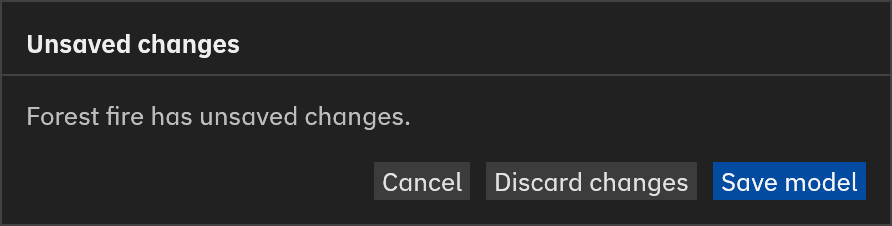
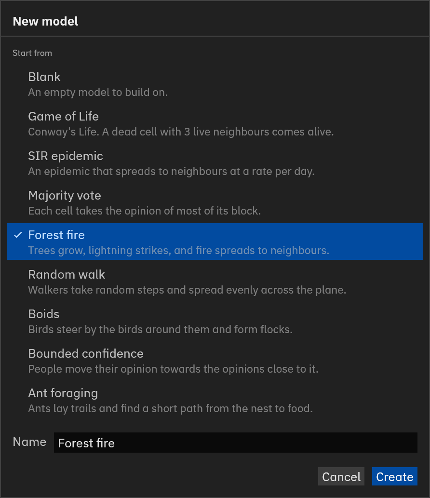
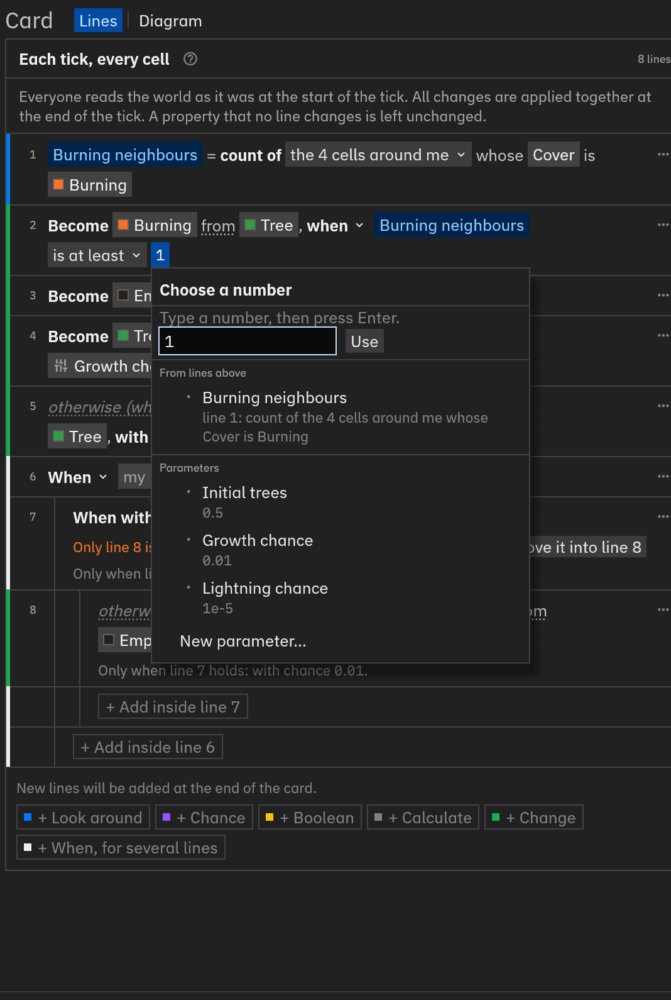
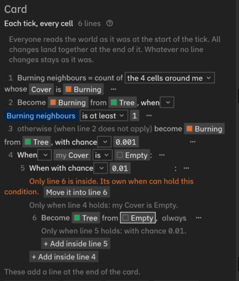

# Editor

The <span class="ui" markdown>:material-code-braces: Editor</span> tab edits a model file and runs its model in the app without a restart.
A *model file* is one TOML file, and it holds one of three kinds of model.
A *sheet* describes a model in sentences, and the Editor shows it as [a sheet and its cards](#sheets).
A *node graph* is built from nodes on a canvas, and the Editor shows it as [a graph](#node-graphs) with a live preview beside it.
A *grid rule* is a GPU grid model written as data, with its step in WGSL, and the Editor shows it as [text](#grid-rules).
The app compiles each kind while it runs, in the official app and in a browser alike, and the model runs on the same GPU engine as the compiled GPU models.

!!! info "Henad 0.4"

    This page describes Henad 0.4.

## Opening the Editor

The Editor is closed in the default layout.
Opening a model in it, in any of the ways below, switches to the [Editor layout](app.md#layouts).
There the Editor takes most of the window, and the <span class="ui" markdown>:material-cube-outline: Viewport</span>, Playback, Charts and Parameters tabs share a column on the right, so the run stays in view while you edit its model.
Uncheck **Open models in the Editor layout** in the View menu to open the Editor in the layout that shows instead, in a panel of its own to the right of the Viewport in the default layout.

- Press <span class="ui" markdown>:material-file-plus-outline: New grid rule</span> in the <span class="ui" markdown>:material-cog-outline: Model</span> tab to open the Editor on the Life starter, Conway's Game of Life written as a grid rule.
- Press <span class="ui" markdown>:material-code-braces: Edit model</span> in the Model tab to open the Editor on the sheet, node graph or grid rule the selected model was built from.
  The button appears only for a model built from one of these, such as a model applied from the Editor.
- Press <span class="ui" markdown>:material-file-document-plus-outline: New model</span> in the Editor or the Model tab to start a [sheet](#sheets), from Blank or from a starter such as Game of Life or Forest fire.
- Press <span class="ui" markdown>:material-graph-outline: New node graph</span> in the Editor and select an example to open it as a node graph: Game of Life, Vote or SIR Epidemic on a grid, or Boids Flocking, Ant Foraging or Random Walk of agents.
- In the menu bar, <span class="ui" markdown>:material-file-outline: File</span> holds New model, New grid rule, New node graph, Open model and Save model, and <span class="ui" markdown>:material-view-dashboard-outline: View</span> toggles the Editor like any other tab and switches between the default layout and the Editor layout.

The Editor's header holds <span class="ui" markdown>:material-file-document-plus-outline: New model</span>, <span class="ui" markdown>:material-file-plus-outline: New grid rule</span>, <span class="ui" markdown>:material-graph-outline: New node graph</span>, <span class="ui" markdown>:material-folder-open-outline: Open model</span> and <span class="ui" markdown>:material-tray-arrow-down: Save model</span>, and <span class="ui" markdown>:material-check: Apply</span> at the right end.
The row under it shows the model's name, a dot while the model holds changes you have not saved, and the name of its file.
For a sheet, the row also holds <span class="ui" markdown>:material-undo: Undo</span>, <span class="ui" markdown>:material-redo: Redo</span> and the **Model actions** menu, shown as <span class="ui" markdown>:material-dots-horizontal:</span>.

Under the panes, the Editor lists its messages: the state of the preview, the outcome of the last open, save or Apply, and each problem.
Each message starts with an icon in the colour of its kind, blue for information, orange for a warning and red for an error.

New model, New grid rule, New node graph and Open model replace the Editor's model, and so does Open in Editor in the Results tab.
Edit model replaces it too, but keeps the model, your edits since the last Apply included, while the selected model runs the code the Editor applied last.
While the model holds changes you have not saved since you opened or made it, a dialog names it first, such as **Game of Life has unsaved changes.**
Press <span class="ui">Save model</span> to save it and then replace it, <span class="ui">Discard changes</span> to replace it without saving, or <span class="ui">Cancel</span> to keep it.

{ width="446" }

Closing the window of the desktop app asks the same, and so does <kbd>Cmd</kbd>+<kbd>Q</kbd> (<kbd>Ctrl</kbd>+<kbd>Q</kbd> outside macOS).
The app closes once the model is saved or its changes discarded.
On macOS the app menu has no Quit item, and Quit in the Dock closes the app without asking.
In a browser, closing or reloading the tab with unsaved changes makes the browser ask whether to leave the page.
Apply does not save the model, and a save you cancel keeps it in the Editor.
If you change the model while the open or save dialog is open, the Editor asks again before it replaces the model.
A sheet converted to a node graph is held beside its copy, and the dialog names it too while it holds unsaved changes.
Converting the sheet again replaces the copy held beside it, so the dialog asks first while that copy holds unsaved changes, and the sheet keeps its own.

## Sheets

<span class="ui" markdown>:material-file-document-plus-outline: New model</span> opens the **New model** dialog.
Under **Start from** it lists **Blank**, then eight starters, each with a line on what it models: Game of Life, SIR epidemic, Majority vote and Forest fire on a grid of cells, and Random walk, Boids, Bounded confidence and Ant foraging of agents.
While **Blank** is chosen, **What is the world made of?** under it picks **Cells on a grid** or **Agents in open space**.
**Name** follows the choice until you type in it, and <span class="ui">Create</span> or <kbd>Enter</kbd> opens the model.

{ width="446" }

A sheet opens in two panes beside each other.
**Sheet** lists what the model holds: its purpose, the world, the cells' properties, the parameters, the measures, the colours and the buttons.
**Card** lists the lines every cell, or every agent, follows each tick, numbered from 1, each as a sentence such as "Become Alive from Dead, when Alive neighbours is 3".
The world itself runs in the <span class="ui" markdown>:material-cube-outline: Viewport</span>, and the Playback, Pacing, Parameters and Charts tabs control it as they control any model.
Hover over the question mark beside each heading to read a short explanation and an example.

{ width="700" }

Every change on either pane is one step of <span class="ui" markdown>:material-undo: Undo</span> and <span class="ui" markdown>:material-redo: Redo</span>, on the second row of the Editor's header beside the model's name.
A click on the name renames the model.

### The Sheet pane

The pane holds one section for each part of the model, its title followed by a rule that runs to its question mark at the right end.
A section that lists several things, such as the properties under **Cells** or the **Parameters**, lists them in a table under a row of column headings, and a button at its end adds one more, such as **+ Add parameter**.
A field applies what you type when you press <kbd>Enter</kbd> or move away from it, and <kbd>Escape</kbd> puts back what the sheet holds.
In the purpose, <kbd>Enter</kbd> starts a new line, and <kbd>Escape</kbd> applies what you typed.

**World** sets the size of the grid in cells, its edges, and the length of one tick.
With **Wrap around**, the left edge joins the right edge and the top edge joins the bottom.
With **Walls**, cells on an edge have fewer cells around them.
**One tick is** reads "one step (no unit)" until you give a tick a length, such as 1 day.
The length must be greater than 0.

**Cells** lists every property a cell has, with its kind, how it starts and the lines that change it.
Press **+ Add property** for a property of a few named states, such as Dead and Alive, or of a number.
Each state takes a colour, and a few usual names take their usual colour as you type them, such as green for Tree and orange for Burning.
**Starts as** sets every cell to one state, or draws the states by chance, each row a state with its chance and a last row for the cells no chance picks.
**Changed by** lists the lines of the card that change the property.
Press **Edit** at the end of a row to change the property's name, kind or states, and **×** to delete it.
Where the Sheet pane is too narrow for both, a menu at the end of each row holds them.
A delete that would empty a formula the card cannot write again asks first.
A symbol before each property and parameter, here and in the **Colours** selects, shows its type, such as a dot for a number and an arrow for a vector, as the Statistics tab shows them, and the type's name shows under the pointer.
Uncheck **Show type symbols on sheets** in the View menu to hide them.

**Parameters** lists the named numbers lines can use, each with its value, its range and an optional unit.
The value on the sheet is the one the model keeps.
A parameter named after a column of sweep results, such as Population, takes the id `population_2`, since `runs.csv` writes a `population` column of its own.
**Measures** plots a number worked out from every cell: turn on **Plot** beside a state to plot how many cells are in it.
An average keeps the name it was given, such as "Average of Food", in step with its property: renaming Food to Energy renames it "Average of Energy", and the column of the results with it, until you rename the measure yourself.
A measure cannot be named run_id, tick or time, the names of the first columns of exported stats and sweep results.
**Colours** chooses the property that colours the cells in the Viewport, or **None** for black cells, white agents or no ground.
With no other choice, cells and agents take the colours of their first States property, and a new model of agents is coloured by heading.
**Buttons** adds a button beside the world, either to start again or to run its own short card of lines once on every cell.

### The Card pane

Each card is a frame with its heading, such as "Each tick, every cell", and its number of lines at the right end.
Under the heading, grey words give the rule every line follows: everyone reads the world as it was at the start of the tick, all changes are applied together at the end of the tick, and a property that no line changes is left unchanged.

A line either works out a result, which lines below it can use, or changes one of the cell's properties.
A bar at the left of each line shows its kind by colour, as the square on each add button does: blue for a look around, purple for a chance, yellow for a Boolean, grey for a calculation, green for a change, and white for a When or a Repeat.
Hover over the bar to read the kind.
In a sentence, each chosen value is a *chip*: a result in blue, a state with its colour, a parameter with a slider mark, and "my" before a property in grey.
An empty slot is a *blank*, a faint box that names what goes in it, such as "state" or "old state".
Hover over a result chip to highlight the line that works it out.

The add buttons under the lines add a line at the end of the card, each from a menu with a pattern of the sentence under every item:

- **+ Look around** counts the cells around a cell whose property is in a state, or totals or averages a number over them.
- **+ Chance** adds a change made by chance or at a rate, or a Boolean result drawn that way that several lines can share.
- **+ Boolean** compares two values, or joins Boolean results, each yes or no, with all of or any of.
- **+ Calculate** works out a number from two numbers.
  A division by 0 gives 0.
- **+ Change** adds a Become, which changes a state, or a Set, which changes a number.
- **+ When, for several lines** adds a When line, whose condition the lines inside it share.

A button's card runs its lines once when the button is pressed, and offers **+ Change** alone.

### Writing a line

A new line's first blank opens its *picker*, which lists what fits there, in groups, each value after the symbol of its type.
A value of a line above that the blank cannot take shows greyed, and its reason shows under the pointer, such as "Flockmates' centre is a vector, and Move to needs a cell."
The same holds for any value the model would refuse there, such as a random number as the distance of a look at agents.
A picker opens as a framed list under its blank, titled with what it asks for, such as **Choose a value**, and a press on a filled chip opens it again.
Where the window has no room for it under the blank, it opens above, and where neither side has room, it opens on the side with more room and scrolls.
A number takes a typed number, a result of a line above, one of the cell's properties, a parameter, or **New parameter…**, which creates one in a dialog and puts it in the blank.
A chance takes a number from 0 to 1 or a percent such as 30%, and rejects anything else as you type it.
"is one of the numbers" takes a list, such as 2, 3, typed in one go.

{ width="536" }

After a choice the keyboard moves to the next blank of the line.
An empty state blank opens by itself, as does the upper number of "is less than … or more than …" after the lower one.
Press <kbd>↓</kbd> and <kbd>↑</kbd> to move through the items of an open picker or menu, and <kbd>Escape</kbd> to close it and return to the control that opened it.
A picker with a box to type a number opens with the keyboard in the box, so a number can be typed at once, and in a long picker the box stays in view under the list.
In an empty box <kbd>↓</kbd> and <kbd>↑</kbd> move to the first and the last item.
Once the box holds a number they move the text cursor, and <kbd>Tab</kbd> moves on to **Use**, from where they reach the items.
A control's tooltip shows while the control has the keyboard focus, as well as under the pointer.

A result takes a name from what it works out, such as "Alive neighbours" for a count of the Alive cells around me, and keeps following it until you rename it.

### Conditions

A change applies when its condition holds.
A new change from **+ Change** starts with an empty "when" blank and does nothing until a condition is chosen.
The blank opens **Choose when**, which lists the Boolean results of the lines above, then the kinds of condition:

- **always**, for a change that applies to every cell in its old state.
- **when … is …**, **when … is at least …**, **when … is at most …**, and **when … is less than … or more than …**, which compare a value.
- **with chance …**, for a change made by chance.
- **at rate … per …**, for a change made at a rate, on a card that runs each tick.

The words "when", "with chance" and "at rate" on a line are plain text.
The small arrow after them opens **Choose when** again to change the kind of condition.

### "otherwise"

Two changes of one property can both apply to a cell, as two Become lines from Tree do in the forest fire.
The lower one then starts with "otherwise (when line 2 does not apply)", and only applies to the cells the higher line leaves alone.
Hover over "otherwise" to highlight the higher line and read which line wins.
The first time a line starts with "otherwise", a notice above the card says why.
Changes that can never apply to the same cell, such as a Become from Dead and a Become from Alive, read no "otherwise".
Moving a line updates its "otherwise".

```text
1  Burning neighbours = count of the 4 cells around me whose Cover is Burning
2  Become Burning from Tree, when Burning neighbours is at least 1
3  otherwise (when line 2 does not apply) become Burning from Tree, with chance Lightning chance
4  Become Empty from Burning, always
5  Become Tree from Empty, with chance Growth chance
```

### Rates

A chance holds once per tick, whatever the length of a tick.
A rate holds per unit of time, such as 0.1 per day, and follows the length of one tick.
A rate is converted to a chance per tick by 1 − e^(−rate × tick), with the tick counted in the rate's unit.
A rate line runs only while one tick has a length, so a model of rates sets **One tick is** under World, such as 1 day.

A new rate starts in the unit of one tick.
A parameter put into a rate gives the line its unit, read from the first "per day" or the like in the parameter's Unit.
A parameter with no Unit takes the line's unit instead, such as "per day", and one Undo takes back both.
A rate's picker lists the parameters whose Unit names a unit of time or none, and a chance's picker leaves out those that name one.
A picker also leaves out a parameter whose range the line cannot use: a Min below 0 for a rate, and a Min or Max outside 0 to 1 for a chance.
The unit select on the line sets a unit by hand.
If one tick has no length yet, choosing a unit sets one tick to 1 of it, and a notice says so: "One tick is now 1 day. Change it on the sheet."

A grey note under a rate line states the chance per tick it gives with the parameters' values, as the SIR epidemic's line 3 does:

```text
3  Become Recovered from Infected, at rate Recovery rate per day
   Each tick (1 day), an Infected cell becomes Recovered with chance 0.0952.
   The rate is converted to a chance by 1 − e^(−0.1 × 1 day).
```

The note reads the values the world tries while a run of the sheet is loaded, and the values the sheet keeps otherwise.
Hover over it to read how long a cell stays in its state on average at this tick length.
The average stay is left out when another line can also take the cell out of that state.
Under an "otherwise" line the note ends with the higher lines whose turn comes first, such as "This chance holds only when line 3 does not apply."
A rate for each infected neighbour gives the chances for 1 and 2 of them, and adds a second note when the chance at the largest count passes one half, such as "Up to 0.909 with 8.", or "Almost 1 with 8." when it rounds to 1, since a shorter tick then gives a more accurate result.
Other notes ask about a rate that looks wrong:

- A rate read per week from a parameter per day says "Infection rate is per day on the sheet, but this line reads it per week."
- A count put in as the rate itself offers **Use a rate for each infected neighbour**.
- A fixed rate below a count of the state it leads to asks "Should this rate grow with the number of Infected neighbours?" and offers **Add for each infected neighbour**.

Two rate lines that take a cell out of one state compete, as Recovered and Dead do out of Infected.
The lower line starts with "or" instead of "otherwise", a thin bracket joins the lines, and one note under the higher line states the chance of leaving and each line's share.
A cell leaves at the sum of the rates, split between the lines in proportion to each rate, whatever the order of the lines.

A button's card has no duration, so it takes chances and no rate.
Removing the unit of one tick leaves every rate line with "Not run yet: set how long one tick is, under World on the sheet".
When the length of one tick changes, a notice under the Time line names the lines that use chances per tick.
Those chances do not change with the tick length.
**Convert to a rate** in the line menu converts a typed chance to the rate that gives the same chance at the current tick, and **Convert to a chance** converts a typed rate back.

### When blocks

A *When block* is a When line and the lines inside it, indented one step, with a thin guide down the indent.
The lines inside apply only to the cells for which the When's condition holds, and a When can hold another When.
A When cannot be always.

Each block ends with a row **+ Add inside line 4**, whose menu lists every kind of line and adds the line at the end of the block.
Inner blocks close before outer ones, so the row of an inner block comes first.
Once the card holds a When, a note above the add buttons says they add a line at the end of the card.

A change added inside a When with no condition starts as "always".
A Become there changes from the state named by the nearest When around it that tests "my [property] is [state]".
A grey note under it says which condition it holds under, such as "Only when line 4 holds: my Status is Dead.", and the **Choose when** picker says that the When already has a condition.
A result inside a When is still worked out for every cell, and only the lines after it inside that When can use it.
An empty When says "Nothing inside yet."

{ width="530" }

Two offers remove a When that its lines do not need:

- A When whose test every line inside it already makes, as "When my Status is Dead" around Become lines from Dead, offers **Remove this When**.
- A When around one change that holds always offers **Move it into line 5**, which moves the When's condition into the change and removes the When.

### Agents

A world of agents runs a card over its kind of agent, such as "Each tick, every bird", and the same add buttons offer the lines agents need.
**+ Repeat…** comes after them on a card over agents alone.

- **+ Look around** counts the agents within a distance whose property is in a state, looks at them and sums them up, picks the neighbouring cell of the ground with the most or the least of a property or one at random, or looks at the cell an agent is on or the cell ahead of it.
- **+ Chance** adds a change made by chance, a Boolean drawn by chance, a random number between two values, or a random direction of a length.
- **+ Calculate** works out a number, chooses the first of several values whose condition holds, or gives one value for each state of a property.
- **+ Change** adds a Become, a Set, a Steer of a number or a vector by a value or towards it, a Keep between that holds a number or a vector's length inside two bounds, a Move by a vector or to a cell, a Leave that marks the ground, and a Record that counts an event.
  A ground property whose marks add up takes at most 65536 on one cell in a tick, and a Leave of a fixed amount that the most agents on one cell can take past that shows a warning under its line.
  A Leave of a worked-out amount shows a warning once the most agents of the kind reach 65536, since nothing bounds the amount.
- **+ Repeat…** adds a Repeat line, whose lines run that many times each tick.
  Its number of times takes an integer parameter, and **New parameter…** there makes one.
  Each time round reads the world as it was at the start of the tick, and the moves and steers inside it add up.
  "Steer Level towards 10, strength 0.5" repeated 4 times from 0 adds 4 × 0.5 × 10 = 20, and a note under the Steer says that its steers add up.
  Each time, the changes of one property inside it are tried from the top, and the first time a change applies decides.
  With "Become A from S, with chance 0.1" above "otherwise become B from S, with chance 0.5", repeated 4 times, 0.174 of the agents in S become A and 0.785 become B.

A look at agents starts with one summary, an average.
The select before each summary changes it to a total, the largest, the smallest or a count, or removes it, and **+** after the summaries adds another.
A summary names itself after what it sums up, such as "average velocity" for the average of their Velocity, "centre" for the average offset to them and "push" for the total offset away from them.
A summary's picker lists each agent's properties as "their Velocity" and the relations "offset to them", "offset away from them" and "distance to them".
The line menu's **Include me in line 1** counts the agent itself among those it looks at, and **Exclude me from line 1** undoes it.
An average, a largest and a smallest of no one are 0, so "smallest of distance to them" is 0 for an agent with no one around.
A Steer towards a value that reads such a summary adds nothing while the look finds no one, whether it reads the summary itself or a Calculate worked out from it.
To steer towards another value while the look finds no one, test the look's count in a row of a Choose.

A value on a card over agents also takes the summaries of the looks above, as "Flockmates' centre", the cells picked above, and new values: a random number between two values, or a random direction of a length.
Press the first words of a new value, such as "a random number between", to open its blank's picker again, where a typed number can take its place.
A number also takes the length of a Vector property, as "length of my Velocity".
Below the last line that changes a property, a value can take "my new Velocity", the value the changes above give it this tick.
Above that line it is not offered.
Move to takes a cell picked or looked at above, and shows the other values above greyed.
A Move to below another Move to that can apply to the same agent reads "otherwise", since the first whose condition holds decides.
An agent whose cell from that line is not open stays where it is.

Boids, built from a blank model of agents:

```text
1  Flockmates = look at birds within Visual range: average of their Velocity (average velocity), average of offset to them (centre)
2  Too close = look at birds within Protected range: total of offset away from them (push)
3  Steer Velocity by Too close's push, strength Separation
4  Steer Velocity towards Flockmates' average velocity, strength Alignment
5  Steer Velocity by Flockmates' centre, strength Cohesion
6  Keep Velocity's length between Min speed and Max speed
7  Move by my new Velocity
```

A card changes a property one way: by Set or by Steer, and an agent's place by Move by or by Move to.
A second way shows under its line in red, such as "Line 3 steers Velocity. This card cannot also set it.", and the model does not build until it is gone.
A look around, a count or a pick of a cell inside a Repeat shows "A look around, a count or a pick of a cell cannot be used inside a Repeat." under its line.
The **+ Add inside** menu of a Repeat shows Count, Look around and Pick a cell greyed out, with that message as their tooltip.

### The line menu

Each line has a menu, "Line 2 actions", always drawn at the end of the line:

- **Rename line 2**, on a result line.
- **Move line 2 up** and **Move line 2 down**, which follow the outline.
  The first line inside a block moves up out of it, the last moves down out of it, a line beside a block moves into it, and a When moves with all its lines.
- **Draw new numbers**, on a line that draws by chance, which gives the line new random numbers.
- **Convert to a rate** on a line with a typed chance outside a Repeat, and **Convert to a chance** on a line with a typed rate, on a card that runs each tick.
  Both keep the chance per tick.
- **Include me in line 2** or **Exclude me from line 2**, on a look at agents.
- **Delete line 2**.
  Deleting a When or a Repeat keeps its lines and moves them out one level.

A line moved above the result it uses says "Uses Alive neighbours, which is below this line" and does not run, and moving it back runs it again.

### Dragging a line

Drag a line by its number to move it.
A grip shows beside the number of the line under the pointer.
While you drag, a copy of the line follows the pointer and the line fades in its place.
A blue line across the card marks where the line will go, indented to the level it will take: inside a When or a Repeat, at its end above its **+ Add inside** row, or after it.
A When or a Repeat moves with all its lines.
A red line marks a place the line cannot go, and the copy says why:

- Another card. A line moves only within its own card.
- Inside another When or Repeat, for a When or a Repeat.
- Inside a Repeat, for a look around, a count or a pick of a cell.

A drop makes the same moves as **Move line 2 up** and **Move line 2 down**, and one Undo takes it back.
Press <span class="ui">Escape</span> to end a drag and leave the line where it was.
The Card pane scrolls while the pointer is near its top or bottom edge.

### Notes under a line

A line that cannot run yet keeps its place on the card and says why under it, such as "Not run yet: choose a state", and the rest of the model runs without it.
The card never blocks editing, apart from one question before a delete.
Deleting a parameter, a property or a line, or removing a summary of a look at agents, empties every formula that uses it.
The card writes again only a formula of one operation on a Calculate line of its own, and the length of a property, such as "length of my Velocity", where a value goes.
Before a delete that would empty any other formula, a measure's included, a dialog names the lines and the measures that use the item.
In the ant foraging model, deleting Trail falloff asks **Trail falloff is used by lines 3 and 4. Delete it?**, and deleting the ground's To food asks **To food is used by the measure Total trail. Delete it?**
Press <span class="ui">Delete</span>, or <span class="ui">Remove</span> for a summary, to go ahead, or <span class="ui">Cancel</span> to keep the item.
Grey notes explain how lines work together:

- Two Become lines from different states say that their order does not matter, as in Game of Life: "Lines 2 and 3 change different cells (Dead and Alive), so their order does not matter."
- Become lines that test one count and settle every value of it say so, as in the majority vote: "Lines 2 and 3 cover every value of B in my block. A cell ends the tick A when it is 0 to 4 and B when it is 5 to 9."
- Become lines that test one count and leave some of its values to no line name those values.
  Those cells keep their state.
- A chance with "for each" shows the chance for 1 and 2 of what it counts.
- A rate shows the chance per tick it gives, as [Rates](#rates) describes.

A note the model's author wrote under a line comes last, in grey, as the ant foraging model's note on its slower trail formation does.

### Running a sheet

A sheet runs at a small size in the Viewport, paused at tick 0 with the start drawn.
Press Play in the Playback tab to run it, or type a tick into **Run to tick** and press <span class="ui" markdown>:material-fast-forward: Run</span> to run the preview to that tick.
A tick behind the current one starts the preview again from the same start first.
Until the first tick, a change redraws the start.
After it, a change that builds starts the world again from tick 0, and a notice says so.
Once the world has left tick 0, the line under the panes reads **Preview runs at 256 × 256 cells. Press Apply to run the model at its own size.**
A change that stops the sheet building leaves the world running the sheet as it was, and the line reads **The world shows the model before the last change. Fix the problems in red to update it.**
After the first tick, a change of **Starts as** waits, and reads "Press Build in the Playback tab to see the change." under its property.
The sheet's buttons sit under the sliders in the Parameters tab, each with a tooltip that says what it does, such as "Run once, every cell", as its row under **Buttons** shows.
While the preview is loaded, the Parameters tab shows the sheet's parameters, without the sizes the preview sets itself, the **Seed** field or the scheduled actions.
Moving a slider tries the value in the preview and leaves the sheet as it is, and a value that only a build reads starts the world again from tick 0.
A note under the slider then reads "Trying this value. The model keeps 0.3.", and the parameter's row on the sheet reads "The world is trying 0.5. The model keeps 0.3."
<span class="ui">Reset</span> under the slider returns to the value the sheet keeps, and <span class="ui">Keep</span> makes the tried value the sheet's own, widening its range to hold it, as one step of Undo.
Press <span class="ui" markdown>:material-check: Apply</span> to install the model at its own size, and <span class="ui" markdown>:material-tray-arrow-down: Save model</span> to save the sheet as a model file.
A model made from a starter keeps the starter's id, and a blank model takes the id its name gives, such as `harbour_seals` for Harbour seals.
Where a model built into the app already holds that id, such as the example model Game of Life holds `game_of_life`, the new model takes `sheet_` before it.
The Game of Life starter's id is `sheet_game_of_life`, and so is the id of a blank model named Game of Life, so either model joins the model list beside the example, and the list shows the id after each of the two names.
Apply of a new model therefore never replaces a model built into the app, while it does replace a model you applied before under the same id.
When that model was applied from a sheet of another name, Apply asks first, as in **Replace the applied model Chance SIR? It has the same id as this model, untitled_model.**
Press <span class="ui">Replace</span> to apply the sheet in its place, or <span class="ui">Cancel</span> to keep the applied model.
A rename of the sheet you applied last replaces it without asking.
A sheet that holds a problem still opens, with the problem under its line, or listed under the panes when no line holds it.
[Sheets](../reference/model-files.md#sheets) in the model file reference describes the file.

While a run of another model is past tick 0, the preview waits, and the Editor reads **Preview waits for the running model. Press Offload in the Playback tab to preview this model.**
Apply then installs the sheet and selects it, and the run keeps going.
The Editor reads **Model applied. Press Build to run it.**, and <span class="ui" markdown>:material-restart: Build</span> replaces the run with the sheet at its own size.
Press <span class="ui" markdown>:material-tray-remove: Offload</span> instead to end the run, and the preview takes the Viewport.
The Editor then reads **Preview at 256 × 256 cells starts at tick 0. Press Play to run it, or Apply to run the model at its own size.**, or the number of agents, and **Press Apply to check and install the model.**
Build now starts the preview again from tick 0, and Apply runs the sheet at its own size.

### Fire counts

While the sheet runs, a grey number at the right of each change line counts the cells or agents that line applied to in the last tick.
Hover over it to read the line, the count and the tick, such as "Line 2 applied to 2 cells in tick 4.".
The counts stay at their last values while the run is paused, and disappear after a change until the world built from it runs a tick.

A line that works out a result has no count.
A change other than a Become that always applies has no count either, since it applies to every cell or agent.
A Become that reads "otherwise" counts only the cells it applied to, and the lines of a competing group count separately.
A Become from any state also counts the cells already in its state.
A Set that reads "otherwise" and a Move to show no count.
Inside a Repeat a Become counts the agents it changed, and every other change shows no count.

### The Diagram

Press **Diagram**, beside **Lines** after the Card heading, to draw each card as boxes and arrows instead of its lines.
Each line is a box with its sentence, the result it works out on its right, and on its left the results of lines above that it reads.
An arrow runs from a result to every line that reads it, and a frame labelled "Inside line N" surrounds the lines inside each When.
The Diagram is read-only: edit the lines to change it, and press **Lines** to return to them.

### Converting to a node graph

A sheet can be copied to a node graph, the form Henad runs, for edits the card cannot write.
Choose **Convert to node graph** from the **Model actions** menu, <span class="ui" markdown>:material-dots-horizontal:</span> after Redo, or press **Edit as node graph** at the top of the Diagram.
A dialog says what the conversion does, and **Convert** makes the copy.
Both controls are disabled while the card holds a problem or a line that does not run yet, and their tooltip says which.

The conversion runs one way.
The copy is a new model, named after the sheet with "(expert)" added, and the sheet stays as it is.
The copy has no sheet or cards, so lines, fire counts and "otherwise" do not appear in it, and changes to the copy cannot be turned back into lines.
On the desktop, a sheet opened from a file has its copy saved beside that file.

The copy opens on the canvas with a frame around the nodes of each line, titled with the line's number and sentence, such as "Line 2: Become Alive from Dead, when Alive neighbours is 3".
It opens at a zoom its nodes can be read at, from the top left corner of a pass too large to fit, and Frame all shows every node.
Nodes several lines share sit in a frame naming them all, and nodes made by the sheet itself, such as a start or a measure, in a grey frame.
A node shows its kind's name, such as **Is** or **Count around me**, over the kind as the file writes it, such as `cmp.eq`.
A node named on the card, such as "Alive neighbours", shows that name instead.
The inputs of the node that changes a state read by line, such as "Line 2 when".

A banner above the canvas says which sheet the copy came from and when, and whether the copy was edited since.
Press the banner's button named after the sheet, such as **Open Game of Life**, to return to the sheet, whose name row then shows "Converted to node graph:" and the copy's name, a link back to the copy.
The banner says when the sheet's model has changed since the conversion, or when the sheet is not beside the copy's file.
A sheet saved beside the copy with an error counts as changed, and the banner's button still opens it.
An edit of the sheet that leaves its code alone, such as a note, a comment, the purpose or what a parameter means, does not count as a change.
The panel beside the canvas ends with **From the author model**, naming the sheet, its file and the date of the conversion, then the sheet's purpose and what each parameter means, which the node graph has no place for.

Once an edit of the copy adds, removes or changes a node, press **Show changes** in the banner to list every node added, removed or changed since the conversion, at the top of the panel beside the canvas.
Each node is listed under the title of the frame it sits in, and nodes added after the conversion, which join no frame, under "Not in a frame".
Press a listed node to open it on its canvas.
On the canvas, an added node carries a green **Added** badge and a changed node a yellow **Changed** badge.
Press **Show changes** again to hide the list and the badges.

Press **Compare runs** in the banner to run the copy and the sheet side by side for 200 ticks, at the seed the Parameters tab sets and at the preview's size.
When both runs finish, a line under the banner says whether the copy matches the sheet at every tick, or names the first tick at which a measure differs, with both values.
A plot shows each measure of the sheet as a solid line and the copy's as a dashed line, with a vertical line at the first difference.
An unedited copy of a model that replays exactly matches the sheet at every tick, since the conversion copies every random draw.
A model that does not replay exactly, such as bounded confidence or boids, adds up numbers in the order its agents are found, so two of its runs at one seed can differ.
For such a model the line names no tick, and the plot shows how far the two runs drift apart.
Press **Close comparison** to stop the runs and close the plot.
An edit of the copy or the sheet closes the comparison, and **Compare runs** runs both again.
Compare runs is unavailable in a browser.

The **Categories** section of the panel beside the canvas holds each state of the copy with its colour.
Press a colour to choose another from the sheet's twelve, type a name under a category and press the plus button to add a state in the next unused colour, or fill in **New category id** and **First variant** and press **Add category** for a category of its own.

## Node graphs

A node graph opens on a canvas.
The panel beside it lists the model's passes by stage, init, tick, stats, view and action, then its functions, and under them the world: the grid's size and edges, or the number of agents and the world's size, and the parameters, lanes, categories, statistics and actions.
Press a pass to open it on the canvas.
A tick pass runs once per tick for every cell or agent, an init pass seeds the cells or agents when the model is built, and an action pass runs when its action is pressed.

On the canvas, a node computes a value from its inputs, and a wire carries a value from an output to an input.
Right-click empty canvas to add a node, or drop a wire on empty canvas to add a node that takes it.
Right-click a node's header for its menu: Frame, Copy, Inputs (bind an input to a parameter, set a constant or clear it), Settings, View in viewport, Add statistic in a stats pass, Move into region, Move out of region and Delete.
A click selects a node, <kbd>Delete</kbd> removes the selection, and <kbd>Cmd</kbd>+<kbd>Z</kbd> (<kbd>Ctrl</kbd>+<kbd>Z</kbd> outside macOS) undoes an edit.
The toolbar above the canvas holds Undo, Redo, Copy, Delete, Repeat, Function, Arrange and Frame all.

### The preview

The Editor runs the graph as a *preview* in the Viewport while you edit it.
A preview is the model at a small size: each side of the grid at most 256 cells, or at most 16384 agents in a world of the model's own size, with every parameter at its default until you try another value.
After each edit that leaves the graph valid, the preview builds again and starts from tick 0 once you pause for a moment.
Moving a node, or pressing Arrange, changes no code and leaves the preview running.
The list under the canvas reads **Preview runs at 256 × 256 cells from tick 0. Press Apply to run the model at its own size.**, or the number of agents, and the Playback tab names the preview.
The sizes in the world panel are left as they are.
The Parameters tab tries a value in the preview as it does for a [sheet](#running-a-sheet), and <span class="ui">Keep</span> makes the tried value the parameter's default.

The preview takes the Viewport only when nothing runs, when the run is still at tick 0, or when the run is a preview.
A run past tick 0 keeps going, and the Editor reads **Preview waits for the running model.** until the run ends.
Pressing <span class="ui" markdown>:material-restart: Build</span> after the edit keeps the Viewport for that run.

An edit that leaves the graph invalid leaves the preview running.
The node with the problem takes a red frame and a badge, and the list under the canvas names the problem with its pass and node, as in **step, n16: Greater n16: the input `b` is f32, expected u32**.
Press the badge, or the problem in the list, to bring the node into view.
A pass with problems shows their number beside its name.

Apply runs the graph at its own size, as for a grid rule, and replaces a preview at any tick.
A model too heavy for the device at its own size is not built, and the Editor reads **Model build failed. Fix the problem below.** over the work it would need.
[Limits of a graph model](../reference/model-files.md#limits-of-a-graph-model) gives the budgets of work.
The preview of the same model can still run, since it is smaller.

### Regions and Repeat

A *region* is a node whose body runs many times for each cell or agent, and whose results are gathered into *accumulators*.
**Repeat** runs its body a counted number of times, a neighbourhood fold runs it once for each neighbouring cell, and a radius fold once for each agent within a radius.
A region draws as two nodes inside a frame: its input half on the left holds its inputs and the values its body reads, such as `k`, the number of the repetition from 0, and its output half on the right holds its accumulators.
The nodes of its body sit inside the frame between the halves.
Each Accumulate node inside the body feeds one accumulator, and the accumulator's rule combines the values: `sum`, `count`, `min`, `max`, `or`, `and`, or `carry`, which keeps the last value and lets the body read it again as `prev.<name>` on the next repetition.

Select nodes and press <span class="ui" markdown>:material-repeat: Repeat</span> to wrap them in a new Repeat that runs once.
The model computes what it did before, and each value the wrapped nodes passed to a node outside becomes a `carry` accumulator.
A selection that holds a node a region body cannot hold, such as a lane write, or an Accumulate node without its region, does not wrap.
Set the Repeat's `count` to a constant, or bind it to a parameter through the node menu's Inputs, and set <span class="ui">Max</span> on its input half, the most repetitions it runs.
A constant count sets Max for you, and a count that can pass Max shows a warning on the node.
<span class="ui">Add accumulator</span> on the input half adds an accumulator, whose name, type and rule each have a field beside it.

Drag a node into a region's frame to move it into the region's body, and use the node menu's Move out of region to take it out again.
A node taken out of a region moves to the right of the region's frame, so it no longer looks like a member.
The frame a node would join takes a blue outline while you drag it.
Right-clicking empty canvas inside a frame adds a node to that region.
Regions nest at most three deep, a Repeat inside a Repeat or a neighbourhood fold and the other way round, and a radius fold neither holds a region nor sits in one.
The menus and the frames offer only the moves that follow these rules.

### Functions

A *function* is a named graph that passes can call, each call a node with the function's inputs and outputs.
The functions panel lists the model's functions.
Press a function to open its body on the canvas, or right-click a call and press Open function, and the toolbar shows where you came from, as in **flock › clamp_speed function**.
Press a name in that breadcrumb to go back.
Inside a function, a Function input node reads one of its inputs and a Function output node sets one of its outputs.
The panel renames the open function, adds, renames, retypes and removes its inputs and outputs, and removes it.
An edit inside a function changes every call, and the preview restarts as for any edit.

Select nodes and press <span class="ui" markdown>:material-function-variant: Function</span> to move them into a new function, named `function` or `function_2` and so on, with a call in their place.
Each value they read from outside becomes an input, and each value a node outside reads becomes an output.
Right-click a call and press Ungroup to put a copy of its function's nodes back in the call's place.
The function stays in the panel until you remove it.
A random draw inside a function draws other numbers for each call, so a selection that draws numbers draws different ones once it becomes a function.
Ungroup keeps the numbers the call drew.

Press <span class="ui" markdown>:material-file-import-outline: Import function</span> and select another model file to list its functions.
Press Import beside one to copy it, and every function it calls, into this model, under the name in the field beside it.
A name the model already uses, or the name of a function the imported one calls, is rejected, so type another one.
The model file records the name of the file each imported function came from.
An import copies the function alone, so a function that reads a lane or a category of the other model shows a problem until this model declares one with the same id.

### Expressions

An Expression node computes its outputs from a short formula, such as `out = if(count > 0, moved + avg * inv, moved)`.
Its body holds the formula, its named inputs with their types, and its outputs, separated by commas.
Each change applies when the field loses focus, and a formula that does not read shows its problem on the node.
Renaming an input keeps the wire it held.

### Generated WGSL and View in viewport

Press <span class="ui" markdown>:material-code-braces: WGSL</span> in the canvas toolbar to show the WGSL compiled for the open pass, read-only, beside the canvas.
Each value is named after its node, so `n13_out` is the output of node n13.
An init pass runs on the host when the model is built and has no WGSL.

Right-click a node and select an output under **View in viewport** to colour the preview by that value, one cell at a time.
A number goes through a colour ramp, a flag shows as the ramp's two ends, and a category shows in its own colours.
The toolbar reads **Viewing n11.count of pass step**, and <span class="ui" markdown>:material-eye-off-outline: Stop viewing</span> returns to the model's own colours.
Viewing changes nothing in the model file.
The value is computed from the cells as they are after each tick, so a value that reads a random draw cannot be viewed.

## Grid rules

A grid rule shows as text, with its line numbers in a gutter beside it.

### The model file

The Life starter is this file without the comments outside its step:

```toml title="life_rule.toml"
--8<-- "crates/henad-explore/specs/models/life_rule.toml"
```

The header names the format, its version and the kind of model, then the rule's `id`, `name` and `description`.
The `id` is the model's id in the app, and a rule whose id is already in the app replaces that model, a built-in one included.

The tables declare the grid, the states and the parameters, and `[step]` holds the step between `'''` and `'''`.
The step defines `fn step_cell(cell: u32, rng: ptr<function, u32>) -> u32`, which returns the next state of one cell.
[Model files](../reference/model-files.md#the-format) lists the keys of each table.
[What the template declares](../reference/model-files.md#what-the-template-declares) lists the names a step reads its neighbours and parameters through, and [Randomness](../reference/model-files.md#randomness) describes how a step draws from `rng`.

### Apply

Press <span class="ui" markdown>:material-check: Apply</span> to check the text and install the rule.
The check reads the file, then compiles the step.
Nothing runs until the check passes.

When it passes, the rule joins the app's models, or replaces the model with its id, and becomes the selected model.
What happens to the run depends on what was running:

- With no run, a run still at tick 0, or a model still building, the rule is built at once and the run starts at tick 0.
  The desktop app builds it on a thread of its own, as [Building a model](app.md#building-a-model) describes, and the Editor reads **Model applied.** from the start of the build.
  Press <span class="ui">Cancel</span> in the Playback tab to stop the build, and the Editor reads **Model applied. Press Build to run it.**
- A run of the same rule past tick 0 opens the **Rebuild model?** dialog, which reads **The model will be rebuilt from tick 0. The current run will be lost.**
  The Editor reads **Model applied. Press Rebuild to run it from tick 0.**
  Press <span class="ui">Rebuild</span> to start the new rule from tick 0, or <span class="ui">Cancel</span> to keep the run going under the code it was built with.
  After Cancel, <span class="ui" markdown>:material-restart: Build</span> runs the new rule, and Apply opens the dialog again.
  The app tour's [Model code changes](app.md#model-code-changes) describes the dialog.
- A run of another model past tick 0 keeps going.
  The Editor reads **Model applied. Press Build to run it.**, and <span class="ui" markdown>:material-restart: Build</span> runs the rule.
  Once you select another model in the Model tab, Build builds that model, and the Editor reads **Press Apply to check and install the model.**

When <span class="ui" markdown>:material-restart: Build</span> or <span class="ui">Rebuild</span> is disabled, for example while the **Seed** field shows an error, the Editor reads **Model build failed. Fix the problem below.** and names the reason instead.
Once the problem is fixed, the line names the button again, as in **Model applied. Press Build to run it.**

Applying the code the run already runs changes nothing, and the Editor reads **Model unchanged.**
Once you edit the model after Apply, the line goes, and the Editor reads **Press Apply to check and install the model.** again.

### Problems

The list under the code shows the outcome of the last Apply.
A text that fails the check leaves the running model alone, and the list names each problem at its line and column, as in **37:5 loops are not allowed in a grid rule. Step functions must be bounded** for a `loop {}` on the line after `let alive` in the Life starter.
The line numbers are those of the gutter beside the code.
Press a problem to move the cursor to it.
The list holds the problems of the last Apply, and an edit since then shows its problems on the next one.

The check rejects a step that could run without end or reach past its own cell.
[What is rejected](../reference/model-files.md#what-is-rejected) lists each rejection, and [Limits](../reference/model-files.md#limits) the sizes a step has to keep within.

The device can still reject a rule that the check passed, as a browser's WebGPU can.
When it rejects the rule as the rule is built, before the run passes tick 0, the Editor reads **Model build failed. Fix the problem below.** over the device's message, and the run is gone.
The message appears a moment after the build starts, instead of **Model applied.**
Fix the text and press Apply to build it again.
A fault that no edit of the text can fix, such as a lost device or a device out of memory, opens the app's fault dialog instead.

## Saving and opening model files

Press <span class="ui" markdown>:material-tray-arrow-down: Save model</span> to save the Editor's text as written, comments included.
A sheet is saved in its canonical form, with each line's sentence as a comment above its table.
A node graph is saved in its canonical form, with the canvas layout in its `[editor]` table.
The desktop app asks where to save, and suggests the name of the file you opened or the model's id.
A browser downloads the file.

Press <span class="ui" markdown>:material-folder-open-outline: Open model</span> to read a `.toml` model file into the Editor.
A sheet opens on its two panes, a node graph on the canvas, and any other file as text.
Opening a file does not apply it.
Press Apply to install it.

A model file holds data and WGSL alone, and its step runs only on the GPU, inside the checks above and the device's own.
It runs no native code.
A heavy step on a large grid can still take long enough per tick to lose the GPU device, as the [model file reference](../reference/model-files.md#limits) describes.

## Limits

- The Editor writes sheets, grid rules, and node graphs on a grid or of agents.
  CPU models cannot be written as a model file.
- The card writes the lines of a world of cells and of a world of agents.
  A formula of more than one operation, a condition on a Steer, Keep between or Move, the "only those whose" filter of a look at agents, a summary's own name and a vector's start are written in the model file.
- A grid rule's step has no initialisation of its own.
  The states' `initial` shares seed the grid at tick 0.
- A grid rule reads its parameters when it is built.
  An edited parameter applies after <span class="ui" markdown>:material-restart: Build</span>.
  A graph model or a sheet takes an edited parameter on the next tick, unless its build reads the parameter, as a start does.
- A grid rule's text has no syntax highlighting, and the Editor checks it only when you press Apply.
- The model in the Editor is not kept when the app closes.
  Save it first.
- The shaders of the compiled GPU models cannot be edited here.
- A results folder of a model file does not install its model in the app.
  <span class="ui" markdown>:material-pencil-outline: Open in Editor</span> in the Results tab opens it in the Editor, and Apply installs it.
- A GPU model runs many ticks per frame, so a small preview can reach the end of its run within a second.
- A grid rule or a graph model needs a GPU with compute support.
  On a device without it, the Editor reads **Grid rules and graph models are unavailable on this device. They need a GPU with compute support.**

*[GPU]: Graphics processing unit
*[CPU]: Central processing unit
*[WGSL]: WebGPU Shading Language
*[TOML]: Tom's Obvious Minimal Language
