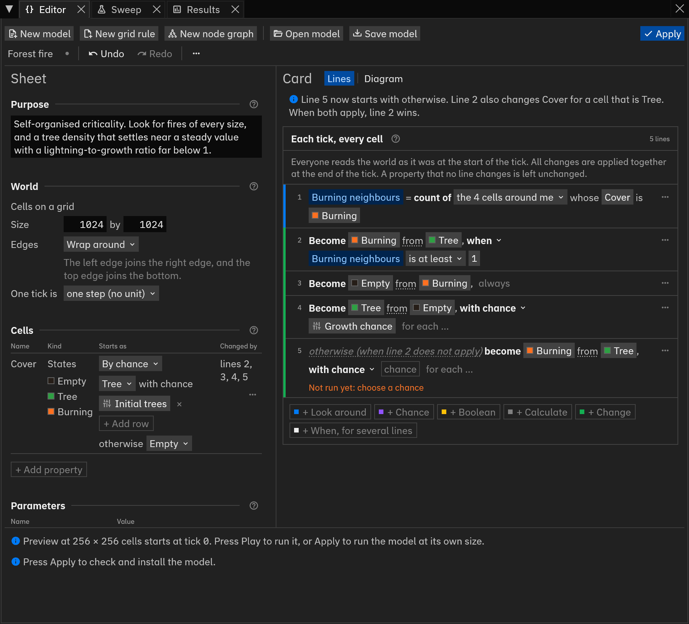

# Editor

The <span class="ui" markdown>:material-code-braces: Editor</span> tab edits a model file and runs its model in the app without a restart.
A *model file* is one TOML file, and it holds one of three kinds of model.
A *sheet* describes a model in sentences, and the Editor shows it as [a sheet and its cards](#sheets).
A *node graph* is built from nodes on a canvas, and the Editor shows it as [a graph](#node-graphs) with a live preview beside it.
A *grid rule* is a GPU grid model written as data, with its step in WGSL, and the Editor shows it as [text](#grid-rules).
The app compiles each kind while it runs, in the official app and in a browser alike, and the model runs on the same GPU engine as the compiled GPU models.

!!! info "Henad 0.4"

    This page describes Henad 0.4.

## Opening the Editor

The Editor is closed in the default layout.
It opens in a panel of its own to the right of the <span class="ui" markdown>:material-cube-outline: Viewport</span>, so the run stays in view while you edit its code.

- Press <span class="ui" markdown>:material-file-plus-outline: New grid rule</span> in the <span class="ui" markdown>:material-cog-outline: Model</span> tab to open the Editor on the Life starter, Conway's Game of Life written as a grid rule.
- Press <span class="ui" markdown>:material-code-braces: Edit model</span> in the Model tab to open the Editor on the model file of the selected grid rule.
  The button appears only for a model applied from the Editor.
- Press <span class="ui" markdown>:material-file-document-plus-outline: New model</span> in the Editor or the Model tab to start a [sheet](#sheets), from Blank or from a starter such as Game of Life or Forest fire.
- Press <span class="ui" markdown>:material-graph-outline: New node graph</span> in the Editor and pick an example to open it as a node graph: Game of Life, Vote or SIR Epidemic on a grid, or Boids Flocking, Ant Foraging or Random Walk of agents.
- In the menu bar, <span class="ui" markdown>:material-file-outline: File</span> holds New model, New grid rule, New node graph, Open model and Save model, and <span class="ui" markdown>:material-view-dashboard-outline: View</span> toggles the Editor like any other tab.

New grid rule and Open model replace the Editor's text.
Edit model replaces it too, but keeps the text, your edits since the last Apply included, while the selected rule runs the code the Editor applied last.
Save what you want to keep first.

## Sheets

A sheet opens in two panes beside each other.
**Sheet** lists what the model holds: its purpose, the world, the cells' properties, the parameters, the measures, the colours and the buttons.
**Card** lists the lines every cell follows each tick, numbered from 1, each as a sentence such as "Become Alive from Dead, when Alive neighbours is 3".
The world itself runs in the <span class="ui" markdown>:material-cube-outline: Viewport</span>, and the Playback, Pacing, Parameters and Charts tabs control it as they control any model.
Each heading has a help button with a short explanation and an example.

{ width="710" }

Every change on either pane is one step of <span class="ui" markdown>:material-undo: Undo</span> and <span class="ui" markdown>:material-redo: Redo</span> in the toolbar above the panes.
The toolbar also holds the model's name, and a click on the name renames the model.

### The Sheet pane

**World** sets the size of the grid in cells, its edges, and how much time one tick stands for.
With **Wrap around**, the left edge joins the right edge and the top edge joins the bottom.
With **Walls**, cells on an edge have fewer cells around them.
**One tick is** reads "one step (no unit)" until you give a tick a length, such as 1 day.

**Cells** lists every property a cell has, with its kind, how it starts and the lines that change it.
Press **+ Add property** for a property of a few named states, such as Dead and Alive, or of a number.
Each state takes a colour, and a few usual names take their usual colour as you type them, such as green for Tree and orange for Burning.
**Starts as** sets every cell to one state, or draws the states by chance, each row a state with its chance and a last row for the cells no chance picks.
**Changed by** lists the lines of the card that change the property.

**Parameters** lists the named numbers lines can use, each with its value, its range and an optional unit.
The value on the sheet is the one the model keeps.
**Measures** plots a number worked out from every cell each tick: tick **Plot** beside a state to plot how many cells are in it.
**Colours** chooses the property that colours the cells in the Viewport.
**Buttons** adds a button beside the world, either to start again or to run its own short card of lines once on every cell.

### The Card pane

Under the card's heading, a grey box holds the rule every line follows: everyone reads the world as it was at the start of the tick, all changes land together at the end of it, and whatever no line changes stays as it was.

A line either works out a result, which lines below it can use, or changes one of the cell's properties.
In a sentence, each chosen value is a *chip*: a result in blue, a state with its colour, a parameter with a slider mark, and "my" before a property in grey.
An empty slot is a dashed *blank* that names what it wants, such as "state" or "old state".
Hover over a result chip to highlight the line that works it out.

The add buttons under the lines add a line at the end of the card, each from a menu with a pattern of the sentence under every item:

- **+ Look around** counts the cells around a cell whose property is in a state, or totals or averages a number over them.
- **+ Chance** adds a change made by chance or at a rate, or a yes or no result drawn that way that several lines can share.
- **+ Yes or no** compares two values, or joins yes or no results with all of or any of.
- **+ Calculate** works out a number from two numbers.
- **+ Change** adds a Become, which changes a state, or a Set, which changes a number.
- **+ When, for several lines** adds a When line, whose condition the lines inside it share.

A button's card runs its lines once when the button is pressed, and offers **+ Change** alone.

### Writing a line

A new line's first blank opens its *picker*, which lists only what fits there, in groups.
A number takes a typed number, a result of a line above, one of the cell's properties, a parameter, or **New parameter...**, which creates one in a dialog and puts it in the blank.
A chance takes a number from 0 to 1 or a percent such as 30%, and refuses anything else as you type it.
"is one of the numbers" takes a list, such as 2, 3, typed in one go.

After a choice the keyboard moves to the next blank of the line.
An empty state blank opens by itself, as does the upper number of "is less than ... or more than ..." after the lower one.
Press <kbd>Escape</kbd> to close a picker.

A result takes a name from what it works out, such as "Alive neighbours" for a count of the Alive cells around me, and keeps following it until you rename it.

### Conditions

A change applies when its condition holds.
A new change from **+ Change** starts with an empty "when" blank and does nothing until a condition is chosen.
The blank opens **Choose when**, which lists the yes or no results of the lines above, then the kinds of condition:

- **always**, for a change that applies to every cell in its old state.
- **when ... is ...**, **when ... is at least ...**, **when ... is at most ...**, and **when ... is less than ... or more than ...**, which compare a value.
- **with chance ...**, for a change made by chance.
- **at rate ... per ...**, for a change made at a rate, on a card that runs each tick.

The words "when", "with chance" and "at rate" on a line are plain text.
The small arrow after them opens **Choose when** again to change the kind of condition.

### "otherwise"

Two changes of one property can both apply to a cell, as two Become lines from Tree do in the forest fire.
The lower one then starts with "otherwise (when line 2 does not apply)", and only applies to the cells the higher line leaves alone.
Hover over "otherwise" to highlight the higher line and read which line wins.
The first time a line starts with "otherwise", a notice above the card says why.
Changes that can never apply to the same cell, such as a Become from Dead and a Become from Alive, read no "otherwise".
Moving a line updates its "otherwise".

```text
1  Burning neighbours = count of the 4 cells around me whose Cover is Burning
2  Become Burning from Tree, when Burning neighbours is at least 1
3  otherwise (when line 2 does not apply) become Burning from Tree, with chance Lightning chance
4  Become Empty from Burning, always
5  Become Tree from Empty, with chance Growth chance
```

### Rates

A chance holds once per tick, whatever a tick stands for.
A rate holds per unit of time, such as 0.1 per day, and follows the length of one tick.
Henad turns a rate into a chance per tick as 1 − e^(−rate × tick), with the tick counted in the rate's unit.
A rate line runs only while one tick has a length, so a model of rates sets **One tick is** under World, such as 1 day.

A new rate starts in the unit of one tick.
A parameter put into a rate gives the line its unit, read from the first "per day" or the like in the parameter's Unit.
A rate's picker lists the parameters whose Unit names a unit of time or none, and a chance's picker leaves out those that name one.
The unit select on the line sets a unit by hand.
If one tick has no length yet, choosing a unit sets one tick to 1 of it, and a notice says so: "One tick is now 1 day. Change it on the sheet."

A grey note under a rate line states the chance per tick it gives with the parameters' values, as the SIR epidemic's line 3 does:

```text
3  Become Recovered from Infected, at rate Recovery rate per day
   Each tick (1 day), an Infected cell becomes Recovered with chance 0.0952. A rate is not a chance.
   Henad turns it into one as 1 − e^(−0.1 × 1 day).
```

The note reads the values the world tries while a run of the sheet is loaded, and the values the sheet keeps otherwise.
Hover over it to read how long a cell stays in its state on average at this tick length.
A rate for each infected neighbour gives the chances for 1 and 2 of them, and adds a second note when the chance at the largest count passes one half, such as "Up to 0.909 with 8.", since a shorter tick then follows the rate more closely.
Other notes ask about a rate that looks wrong:

- A rate read per week from a parameter per day says "Infection rate is per day on the sheet, but this line reads it per week."
- A count put in as the rate itself offers **Use a rate for each infected neighbour**.
- A fixed rate below a count of the state it leads to asks "Should this rate grow with the number of Infected neighbours?" and offers **Add for each infected neighbour**.

Two rate lines that take a cell out of one state compete, as Recovered and Dead do out of Infected.
The lower line starts with "or" in place of "otherwise", a thin bracket joins the lines, and one note under the higher line states the chance of leaving and each line's share.
A cell leaves at the sum of the rates, and each line takes the share its rate gives it, whatever the order of the lines.

A button's card has no duration, so it takes chances and no rate.
Removing the unit of one tick leaves every rate line with "Not run yet: set how long one tick is, under World on the sheet".
When the length of one tick changes, a notice under the Time line names the lines that use chances per tick, which do not follow the time scale.
**Change to a rate** in the line menu turns a typed chance into the rate that gives the same chance at the current tick, and **Change to a chance** turns a typed rate back.

### When blocks

A *When block* is a When line and the lines inside it, indented one step.
The lines inside apply only to the cells for which the When's condition holds, and a When can hold another When.
A When cannot be always.

Each block ends with a row **+ Add inside line 4**, whose menu lists every kind of line and adds the line at the end of the block.
Inner blocks close before outer ones, so the row of an inner block comes first.
Once the card holds a When, a note above the add buttons says they add a line at the end of the card.

A change added inside a When with no condition starts as "always".
A Become there changes from the state named by the nearest When around it that tests "my [property] is [state]".
A grey note under it says which condition it holds under, such as "Only when line 4 holds: my Status is Dead.", and **Choose when** reminds you that the When already gives a condition.
A result inside a When is still worked out for every cell, and only the lines after it inside that When can use it.
An empty When says "Nothing inside yet."

{ width="400" }

Two offers fold a When that holds no more than its lines need:

- A When whose test every line inside it already makes, as "When my Status is Dead" around Become lines from Dead, offers **Remove this When**.
- A When around one change that holds always offers **Move it into line 5**, which moves the When's condition into the change and removes the When.

### The line menu

Each line has a menu, "Line 2 actions", always drawn at the end of the line:

- **Rename line 2**, on a result line.
- **Move line 2 up** and **Move line 2 down**, which follow the outline. The first line inside a block moves up out of it, the last moves down out of it, a line beside a block moves into it, and a When moves with all its lines.
- **Draw new numbers**, on a line that draws by chance, which gives the line new random numbers.
- **Change to a rate** on a line with a typed chance, and **Change to a chance** on a line with a typed rate, on a card that runs each tick. Both keep the chance per tick.
- **Delete line 2**. Deleting a When keeps its lines and moves them out one level.

A line moved above the result it uses says "Uses Alive neighbours, which is below this line" and does not run, and moving it back runs it again.

### Notes under a line

A line that cannot run yet keeps its place on the card and says why under it, such as "Not run yet: choose a state", and the rest of the model runs without it.
The card never blocks editing.
Grey notes explain how lines work together:

- Two Become lines from different states say that their order does not matter, as in Game of Life: "Lines 2 and 3 change different cells (Dead and Alive), so their order does not matter."
- Become lines that test one count and settle every value of it say so, as in the majority vote: "Lines 2 and 3 cover every value of B in my block. A cell ends the tick A when it is 0 to 4 and B when it is 5 to 9."
- Become lines that test one count and leave some of its values to no line name those values. Those cells keep their state.
- A chance with "for each" shows the chance for 1 and 2 of what it counts.
- A rate shows the chance per tick it gives, as [Rates](#rates) describes.

### Running a sheet

A sheet runs at a small size in the Viewport, paused at tick 0 with the start drawn.
Press Play in the Playback tab to run it.
Until the first tick, a change redraws the start.
After it, a change that builds starts the world again from tick 0, and a notice says so.
Press <span class="ui" markdown>:material-check: Apply</span> to install the model at its own size, and <span class="ui" markdown>:material-tray-arrow-down: Save model</span> to save the sheet as a model file.
A sheet that holds a problem still opens, with the problem under its line, or listed under the panes when no line holds it.
[Sheets](../reference/model-files.md#sheets) in the model file reference describes the file.

## Node graphs

A node graph opens on a canvas.
The panel beside it lists the model's passes by stage, init, tick, stats, view and action, then its functions, and under them the world: the grid's size and edges, or the number of agents and the world's size, and the parameters, lanes, categories, statistics and actions.
Press a pass to open it on the canvas.
A tick pass runs once per tick for every cell or agent, an init pass seeds the cells or agents when the model is built, and an action pass runs when its action is pressed.

On the canvas, a node computes a value from its inputs, and a wire carries a value from an output to an input.
Right-click empty canvas to add a node, or drop a wire on empty canvas to add a node that takes it.
Right-click a node's header for its menu: Frame, Copy, Inputs (bind an input to a parameter, set a constant or clear it), Settings, View in viewport, Move into region, Move out of region and Delete.
A click selects a node, <kbd>Delete</kbd> removes the selection, and <kbd>Cmd</kbd>+<kbd>Z</kbd> (<kbd>Ctrl</kbd>+<kbd>Z</kbd> outside macOS) undoes an edit.
The toolbar above the canvas holds Undo, Redo, Copy, Delete, Repeat, Function, Arrange and Frame all.

### The preview

The Editor runs the graph as a *preview* in the Viewport while you edit it.
A preview is the model at a small size: each side of the grid at most 256 cells, or at most 16384 agents in a world of the model's own size, with every parameter at its default.
After each edit that leaves the graph valid, the preview builds again and starts from tick 0 once you pause for a moment.
Moving a node, or pressing Arrange, changes no code and leaves the preview running.
The list under the canvas reads **Preview runs at 256 × 256 cells from tick 0. Press Apply to run the model at its own size.**, or the number of agents, and the Playback tab names the preview.
The sizes in the world panel and the values in the Parameters tab are left as they are.

The preview takes the Viewport only when nothing runs, when the run is still at tick 0, or when the run is a preview.
A run past tick 0 keeps going, and the Editor reads **Preview waits for the running model.** until the run ends.
Pressing <span class="ui" markdown>:material-restart: Build</span> after the edit keeps the Viewport for that run.

An edit that leaves the graph invalid leaves the preview running.
The node with the problem takes a red frame and a badge, and the list under the canvas names the problem with its pass and node, as in **step, n16: Greater n16: the input `b` is f32, and the node needs u32**.
Press the badge, or the problem in the list, to bring the node into view.
A pass with problems shows their number beside its name.

Apply runs the graph at its own size, as for a grid rule, and replaces a preview at any tick.
A model too heavy for the device at its own size is not built, and the Editor reads **Model build failed. Fix the problem below.** over the work it would need.
The preview of the same model can still run, since it is smaller.

### Regions and Repeat

A *region* is a node whose body runs many times for each cell or agent, and whose results are gathered into *accumulators*.
**Repeat** runs its body a counted number of times, a neighbourhood fold runs it once for each neighbouring cell, and a radius fold once for each agent within a radius.
A region draws as two nodes inside a frame: its input half on the left holds its inputs and the values its body reads, such as `k`, the number of the repetition from 0, and its output half on the right holds its accumulators.
The nodes of its body sit inside the frame between the halves.
Each Accumulate node inside the body feeds one accumulator, and the accumulator's rule combines the values: `sum`, `count`, `min`, `max`, `or`, `and`, or `carry`, which keeps the last value and lets the body read it again as `prev.<name>` on the next repetition.

Select nodes and press <span class="ui" markdown>:material-repeat: Repeat</span> to wrap them in a new Repeat that runs once.
The model computes what it did before, and each value the wrapped nodes passed to a node outside becomes a `carry` accumulator.
A selection that holds a node a region body cannot hold, such as a lane write, or an Accumulate node without its region, does not wrap.
Set the Repeat's `count` to a constant, or bind it to a parameter through the node menu's Inputs, and set <span class="ui">Max</span> on its input half, the most repetitions it runs.
A constant count sets Max for you, and a count that can pass Max shows a warning on the node.
<span class="ui">Add accumulator</span> on the input half adds an accumulator, whose name, type and rule each have a field beside it.

Drag a node into a region's frame to move it into the region's body, and use the node menu's Move out of region to take it out again.
A node taken out of a region moves to the right of the region's frame, so it no longer looks like a member.
The frame a node would join takes a blue outline while you drag it.
Right-clicking empty canvas inside a frame adds a node to that region.
Regions nest at most three deep, a Repeat inside a Repeat or a neighbourhood fold and the other way round, and a radius fold neither holds a region nor sits in one.
The menus and the frames offer only the moves that follow these rules.

### Functions

A *function* is a named graph that passes can call, each call a node with the function's inputs and outputs.
The functions panel lists the model's functions.
Press a function to open its body on the canvas, or right-click a call and press Open function, and the toolbar shows where you came from, as in **flock › clamp_speed function**.
Press a name in that breadcrumb to go back.
Inside a function, a Function input node reads one of its inputs and a Function output node sets one of its outputs.
The panel renames the open function, adds, renames, retypes and removes its inputs and outputs, and removes it.
An edit inside a function changes every call, and the preview restarts as for any edit.

Select nodes and press <span class="ui" markdown>:material-function-variant: Function</span> to move them into a new function, named `function` or `function_2` and so on, with a call in their place.
Each value they read from outside becomes an input, and each value a node outside reads becomes an output.
Right-click a call and press Ungroup to put a copy of its function's nodes back in the call's place.
The function stays in the panel until you remove it.
A random draw inside a function draws other numbers for each call, so a selection that draws numbers draws different ones once it becomes a function.
Ungroup keeps the numbers the call drew.

Press <span class="ui" markdown>:material-file-import-outline: Import function</span> and pick another model file to list its functions.
Press Import beside one to copy it, and every function it calls, into this model, under the name in the field beside it.
A name the model already uses, or the name of a function the imported one calls, is refused, so type another one.
The model file records the name of the file each imported function came from.
An import copies the function alone, so a function that reads a lane or a category of the other model shows a problem until this model declares one with the same id.

### Expressions

An Expression node computes its outputs from a short formula, such as `out = if(count > 0, moved + avg * inv, moved)`.
Its body holds the formula, its named inputs with their types, and its outputs, separated by commas.
Each change applies when the field loses focus, and a formula that does not read shows its problem on the node.
Renaming an input keeps the wire it held.

### Generated WGSL and View in viewport

Press <span class="ui" markdown>:material-code-braces: WGSL</span> in the canvas toolbar to show the WGSL compiled for the open pass, read-only, beside the canvas.
Each value is named after its node, so `n13_out` is the output of node n13.
An init pass runs on the host when the model is built and has no WGSL.

Right-click a node and pick an output under **View in viewport** to colour the preview by that value, one cell at a time.
A number goes through a colour ramp, a flag shows as the ramp's two ends, and a category shows in its own colours.
The toolbar reads **Viewing n11.count of pass step**, and <span class="ui" markdown>:material-eye-off-outline: Stop viewing</span> returns to the model's own colours.
Viewing changes nothing in the model file.
The value is computed from the cells as they are after each tick, so a value that reads a random draw cannot be viewed.

## Grid rules

A grid rule shows as text, with its line numbers in a gutter beside it.

### The model file

The Life starter is this file without the comments outside its step:

```toml title="life_rule.toml"
--8<-- "crates/henad-explore/specs/models/life_rule.toml"
```

The header names the format, its version and the kind of model, then the rule's `id`, `name` and `description`.
The `id` is the model's id in the app, and a rule whose id is already in the app replaces that model, a built-in one included.

The tables declare the grid, the states and the parameters, and `[step]` holds the step between `'''` and `'''`.
The step defines `fn step_cell(cell: u32, rng: ptr<function, u32>) -> u32`, which returns the next state of one cell.
[Model files](../reference/model-files.md#the-format) lists the keys of each table.
[What the template declares](../reference/model-files.md#what-the-template-declares) lists the names a step reads its neighbours and parameters through, and [Randomness](../reference/model-files.md#randomness) describes how a step draws from `rng`.

### Apply

Press <span class="ui" markdown>:material-check: Apply</span> to check the text and install the rule.
The check reads the file, then compiles the step.
Nothing runs until the check passes.

When it passes, the rule joins the app's models, or replaces the model with its id, and becomes the selected model.
What happens to the run depends on what was running:

- With no run, a run still at tick 0, or a model still building, the rule is built at once and the run starts at tick 0.
  The desktop app builds it on a thread of its own, as [Building a model](app.md#building-a-model) describes, and the Editor reads **Model applied.** from the start of the build.
  Press <span class="ui">Cancel</span> in the Playback tab to stop the build, and the Editor reads **Model applied. Press Build to run it.**
- A run of the same rule past tick 0 opens the **Rebuild model** dialog, which reads **The model will be rebuilt from tick 0. The current run will be lost.**
  The Editor reads **Model applied. Press Rebuild to run it from tick 0.**
  Press <span class="ui">Rebuild</span> to start the new rule from tick 0, or <span class="ui">Cancel</span> to keep the run going under the code it was built with.
  After Cancel, <span class="ui" markdown>:material-restart: Build</span> runs the new rule, and Apply opens the dialog again.
  The app tour's [Model code changes](app.md#model-code-changes) describes the dialog.
- A run of another model past tick 0 keeps going.
  The Editor reads **Model applied. Press Build to run it.**, and <span class="ui" markdown>:material-restart: Build</span> runs the rule.

Applying the code the run already runs changes nothing, and the Editor reads **Model code unchanged.**

### Problems

The list under the code shows the outcome of the last Apply.
A text that fails the check leaves the running model alone, and the list names each problem at its line and column, as in **37:5 loops are not allowed in a grid rule. Step functions must be bounded** for a `loop {}` on the line after `let alive` in the Life starter.
The line numbers are those of the gutter beside the code.
Press a problem to move the cursor to it.
The list holds the problems of the last Apply, and an edit since then shows its problems on the next one.

The check refuses a step that could run without end or reach past its own cell.
[What is refused](../reference/model-files.md#what-is-refused) lists each refusal, and [Limits](../reference/model-files.md#limits) the sizes a step has to keep within.

The device can still refuse a rule that the check passed, as a browser's WebGPU can.
When it refuses the rule as the rule is built, before the run passes tick 0, the Editor reads **Model build failed. Fix the problem below.** over the device's message, and the run is gone.
The message appears a moment after the build starts, in place of **Model applied.**
Fix the text and press Apply to build it again.
A fault that no edit of the text can fix, such as a lost device or a device out of memory, opens the app's fault dialog instead.

## Saving and opening model files

Press <span class="ui" markdown>:material-tray-arrow-down: Save model</span> to save the Editor's text as written, comments included.
A sheet is saved in its canonical form, with each line's sentence as a comment above its table.
A node graph is saved in its canonical form, with the canvas layout in its `[editor]` table.
The desktop app asks where to save, and suggests the name of the file you opened or the rule's id.
A browser downloads the file.

Press <span class="ui" markdown>:material-folder-open-outline: Open model</span> to read a `.toml` model file into the Editor.
A sheet opens on its two panes, a node graph on the canvas, and any other file as text.
Opening a file does not apply it.
Press Apply to install it.

A model file holds data and WGSL alone, and its step runs only on the GPU, inside the checks above and the device's own.
It runs no native code.
A heavy step on a large grid can still take long enough per tick to lose the GPU device, as the [model file reference](../reference/model-files.md#limits) describes.

## Limits

- The Editor writes sheets, grid rules, and node graphs on a grid or of agents.
  CPU models cannot be written as a model file.
- The card writes the lines of a world of cells.
  The lines of a world of agents show on the card, and are written in the model file.
- A step has no initialisation of its own.
  The states' `initial` shares seed the grid at tick 0.
- A grid rule or a graph model reads its parameters when it is built.
  An edited parameter applies after <span class="ui" markdown>:material-restart: Build</span>.
- The Editor has no syntax highlighting, and checks the text only when you press Apply.
- The text is not kept when the app closes.
  Save it first.
- The shaders of the compiled GPU models cannot be edited here.
- A results folder of a grid rule cannot rebuild the rule in the app.
- A GPU model runs many ticks per frame, so a small preview can reach the end of its run within a second.
- A grid rule or a graph model needs a GPU with compute support.
  On a device without it, the Editor reads **Grid rules and graph models cannot run on this device. They need a GPU with compute support.**

*[GPU]: Graphics processing unit
*[CPU]: Central processing unit
*[WGSL]: WebGPU Shading Language
*[TOML]: Tom's Obvious Minimal Language
